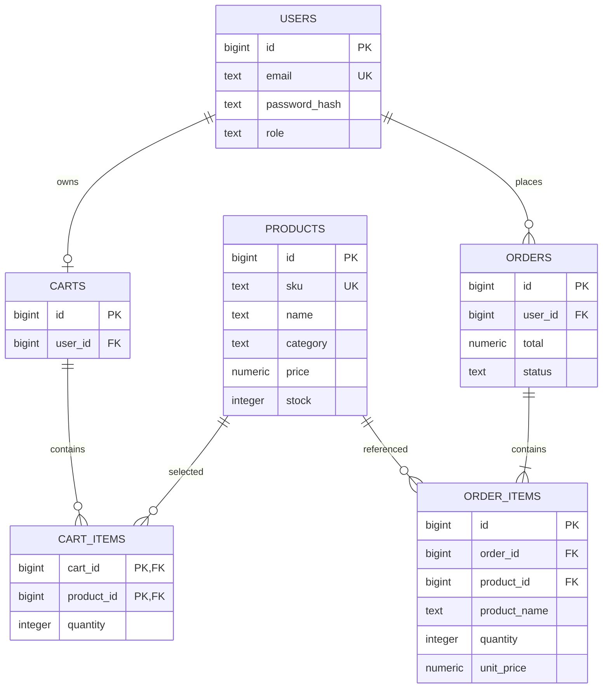

# E-Commerce Order & Inventory API

A single Node.js/Express service backed by PostgreSQL. Redis caches product
listing responses. The code keeps the main ideas visible: normalized tables,
parameterized SQL, JWT auth, and one SQL transaction for checkout.

## Run locally

Requirements: Node.js 18+ and Docker Compose.

1. Copy `.env.example` to `.env`. Replace `JWT_SECRET` with a random string of
   at least 32 characters.
2. Start PostgreSQL and Redis: `docker compose up -d`.
3. Install packages: `npm install`.
4. Start the API: `npm start`.

At startup, the service applies `schema.sql` and listens on
`http://localhost:8000`. Keep `.env` private. The credentials in Compose are
for local development only.

## Deploy on Render

1. Create a managed PostgreSQL database and a Key Value instance in Render.
   Put them in the same region as the API service.
2. Create a Node web service from this GitHub repository. Use `npm ci` as the
   build command and `npm start` as the start command.
3. Add these environment variables to the web service:
   - `DATABASE_URL`: the PostgreSQL internal connection URL.
   - `REDIS_URL`: the Key Value internal connection URL.
   - `JWT_SECRET`: a newly generated random secret with at least 32 characters.
4. Deploy. The app reads Render's `PORT`, listens on `0.0.0.0`, and applies
   `schema.sql` at startup.

Use the internal database and cache URLs from Render when the services share a
region. Never copy the local `.env` or the local Compose credentials into a
public repository. Managed database and cache plans have their own limits and
costs; check those in Render before creating them.

## Data model



`order_items.product_name` and `unit_price` are intentional snapshots. They
preserve what the customer bought if a product is renamed or repriced later.
The schema also puts important invariants in PostgreSQL: unique emails/SKUs,
positive line quantities, non-negative prices, and non-negative stock.

## API

JSON errors use `{ "error": "..." }`. Protected routes require
`Authorization: Bearer <token>`.

| Method | Route | Access | Purpose |
| --- | --- | --- | --- |
| `POST` | `/auth/register` | public | Create a customer account |
| `POST` | `/auth/login` | public | Verify password and return a one-hour JWT |
| `GET` | `/products?page=1&limit=20&search=book&category=stationery` | public | Search/filter catalog with pagination |
| `GET` | `/products/:id` | public | Fetch one product |
| `POST` | `/products` | admin | Create a product |
| `PUT` | `/products/:id` | admin | Update catalog fields and stock |
| `GET` | `/cart` | customer | Read the signed-in customer's cart |
| `POST` | `/cart/items` | customer | Add a quantity to a product in the cart |
| `DELETE` | `/cart/items/:productId` | customer | Remove a product from the cart |
| `POST` | `/orders` | customer | Place the current cart as an order |
| `GET` | `/orders?page=1&limit=20` | customer | List the signed-in customer's orders |

### First admin

Register normally, then promote that account in the local database:

```sql
UPDATE users SET role = 'admin' WHERE email = 'you@example.com';
```

Log in again after changing the role so the new JWT contains the admin role.
Public registration always creates a customer; it cannot choose its own role.

### Example requests

```sh
curl -X POST http://localhost:8000/auth/register \
  -H 'Content-Type: application/json' \
  -d '{"email":"customer@example.com","password":"correct-horse-1"}'

curl -X POST http://localhost:8000/auth/login \
  -H 'Content-Type: application/json' \
  -d '{"email":"customer@example.com","password":"correct-horse-1"}'

curl 'http://localhost:8000/products?search=notebook&page=1&limit=10'
```

Use the returned token as `Authorization: Bearer TOKEN` on cart and order
requests. Admins can create a product with `POST /products` and JSON fields
`name`, `sku`, `category`, `price`, and optional `description` and `stock`.

## Engineering notes

- **Overselling:** checkout starts a PostgreSQL transaction and locks the
  matching product rows using `SELECT ... FOR UPDATE`. It validates stock,
  writes the order and item snapshots, subtracts stock, clears the cart, then
  commits. Any error rolls back every change. The row lock makes concurrent
  checkouts for the same product wait and then see the updated stock. This is
  database transaction coordination inside one service, not distributed
  locking.
- **Indexes/search:** unique indexes support email and SKU lookups. A composite
  `(category, id)` index supports category-filtered ordered listings, a
  `pg_trgm` GIN index supports substring name search, and `(user_id,
  created_at)` supports a customer's order history. `LIMIT`/`OFFSET` keeps the
  API interface easy to follow; cursor pagination is a later option for very
  deep pages.
- **Cache:** product list results are cached in Redis for 60 seconds using the
  filters and page as the key. Product create/update increments a catalog
  version used in cache keys, so new requests bypass old entries without
  scanning or deleting keys. Old entries expire on their own. Product detail
  reads go straight to PostgreSQL to keep invalidation behavior easy to follow.
- **Latency claims:** no before/after performance number is claimed because
  this workspace has not been benchmarked with a representative dataset. Use
  `EXPLAIN (ANALYZE, BUFFERS)` and repeatable request measurements before
  putting a percentage on a resume.

## Deliberate scope limits

This is a learning project: it does not include refresh tokens, rate limiting,
payments, order cancellation/restocking, or deployment hardening. The single
API process is enough to demonstrate SQL transactions and caching without
adding distributed locks or service-to-service complexity.

## Testing

Tests use Jest and Supertest against a real PostgreSQL and Redis (no mocks). They run
against a dedicated database whose name must contain `test`, because they truncate tables.

```bash
docker compose up -d
docker compose exec postgres createdb -U ecommerce ecommerce_test
npm test                # run the suite
npm run test:coverage   # with a coverage report
```

Override the connections with `TEST_DATABASE_URL` and `TEST_REDIS_URL` if needed.

The suite covers auth, role-based access, product CRUD, Redis cache invalidation, cart
behaviour, order snapshots, and concurrent checkouts (no overselling, no deadlocks).
GitHub Actions runs it on every push and pull request (`.github/workflows/ci.yml`).

## Load testing

```bash
npm run load
```

Seeds 5,000 products, then measures listing latency with a warm cache vs. cache misses, and
fires 200 concurrent checkouts at 100 units of stock, verifying nothing is oversold. Results
are written to `load-test/results.json` and depend on your machine.
